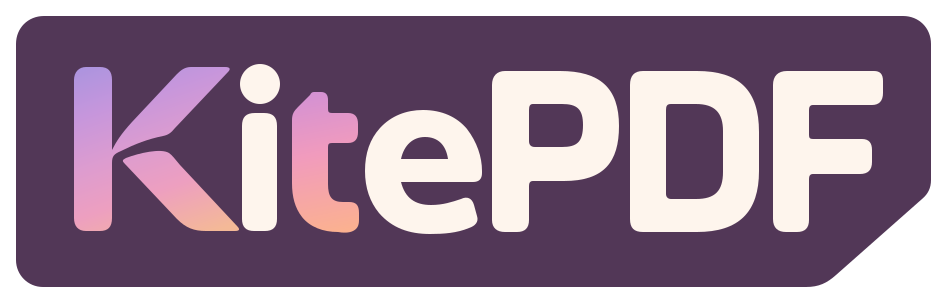
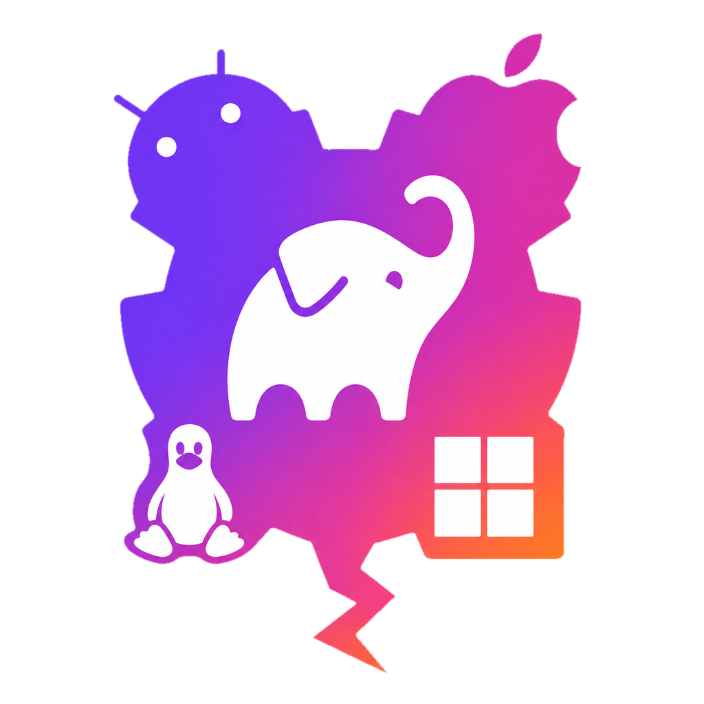

<picture>
  <source media="(prefers-color-scheme: dark)" srcset="assets/hero-dark.svg">
  
</picture>

I mostly write Kotlin Multiplatform (KMP) libraries. I keep their dependencies
to a minimum. I also aim for zero `expect`/`actual` declarations which makes
commonMain code run the same on every platform.

I use AI tools to automate most of my work. I review their output carefully, so
the quality matches what I would write by hand.

## Featured

<table align="left">
<tr><td align="center" width="380">
 
  
<b><a href="https://github.com/yuroyami/syncplay-mobile">Synkplay</a></b>  
   
Watch videos in sync with friends on Android and iOS. Anyone on a computer can join the same room with Syncplay.
  
</td></tr>
</table>

<table align="right">
<tr><td align="center" width="380">
 
  
<b><a href="https://github.com/yuroyami/KitePDF">KitePDF</a></b>  
   
Read, create, edit, and display PDFs, and open EPUB books. It is pure Kotlin, so the same code runs on Android, iOS, desktop, and the web.
  
</td></tr>
</table>

 

<table align="left">
<tr><td align="center" width="380">
 
&nbsp;&nbsp;&nbsp;&nbsp;  
<b><a href="https://github.com/yuroyami/KitePlayer">KitePlayer</a></b> + <b><a href="https://github.com/yuroyami/KiteFFmpeg">KiteFFmpeg</a></b>  
    
KiteFFmpeg adds FFmpeg to your project as one Gradle dependency, with no NDK and nothing to install. Use it to convert, trim, and transcode video and audio. KitePlayer is a media player built on KiteFFmpeg. Its core is 100% Kotlin, so it plays the same on every platform. It supports subtitles, live streams, and hardware decoding.
  
</td></tr>
</table>

<table align="right">
<tr><td align="center" width="380">
 
  
<b><a href="https://github.com/yuroyami/KiteConfig">KiteConfig</a></b>  
   
Set your app name, icon, version, and IDs once, in one Gradle block. Android, iOS, and desktop all read from it, so they never drift apart.
  
</td></tr>
</table>

 

## Other useful libraries

### Kodecs

The Kodec libraries read and write file formats in pure Kotlin, with the same
code on every platform.

| Library | Purpose |
| :--- | :--- |
| **[ImageKodec](https://github.com/yuroyami/ImageKodec)** | Decode and encode images (PNG, JPEG, GIF, WebP, AVIF, JPEG XL, and more), with a Coil adapter for Compose. |

### More

| Library | Purpose |
| :--- | :--- |
| **[KiteJS](https://github.com/yuroyami/KiteJS)** | Run JavaScript from shared code, with Rhino or QuickJS behind one API. |
| **[KiteCore](https://github.com/yuroyami/KiteCore)** | The small helpers every project rewrites, like `String.format()` and `Dispatchers.IO` in commonMain. |
| **[Kite3D](https://github.com/yuroyami/Kite3D)** | 3D math: vectors, matrices, quaternions, and bounding volumes, with the same API as three.js. |
| **[libmpvKt](https://github.com/yuroyami/libmpvKt)** | The mpv player engine for Android, prebuilt, with a typed Kotlin API. |

## Upcoming Kite libraries

These libraries all exist and build, but I have not tested them enough to trust
them yet. Each one stays private until it proves that it works, and then it
goes public.

| Library | Purpose |
| :--- | :--- |
| **KiteQR** | Scan and create QR codes and barcodes. |
| **ArchiveKodec** | Zip and unzip anywhere, plus TAR, gzip, LZ4, and Snappy. |
| **AudioKodec** | Decode, encode, and tag audio files. |
| **KiteSynth** | A synthesizer: it reads a SoundFont, takes MIDI notes, and turns them into sound. |
| **KiteRT** | Real-time audio output. Your code makes the samples, and KiteRT sends them to the speakers. |
| **KiteMIDI** | Read and write MIDI files, and talk to real instruments over USB and Bluetooth. |
| **KiteTorrent** | Download and seed torrents from shared code: magnet links, encryption, peer discovery. |

## Upcoming apps

These are the apps I am working on now. Each one runs on every platform from a single Kotlin codebase.

| App | Purpose |
| :--- | :--- |
| **PINGETTO** | Check your network latency with ping. |
| **Luddy** | One download manager for every screen: torrents and direct links, streamed while they download. |
| **ChatStrata** | Read the chat backups you download from Facebook, Instagram, Snapchat, and others. |
| **Peerora** | Send files between your devices. |

 

